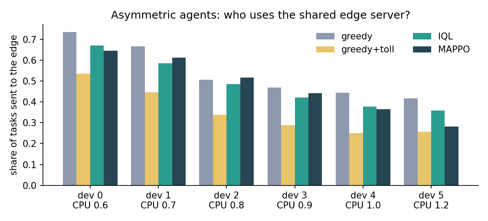
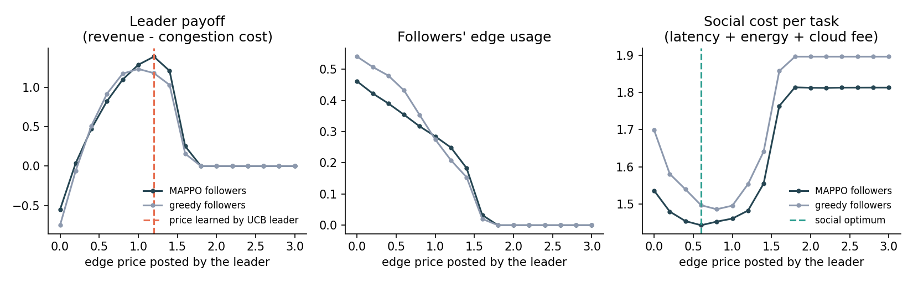

# MARL-Offload

Multi-agent reinforcement learning for distributed computation offloading in an edge-cloud system, with a hierarchical (leader-follower) pricing variant.

This is a small, self-contained research project. It asks a simple question: when several heterogeneous devices share an edge server, can independent learners, with only local information, coordinate better than a myopic rule? Then it adds a leader (the edge operator) who sets a price and anticipates how the devices will react.

An interactive report (results, figures, review log) is built by `python scripts/report.py results` into `results/report.html`.

## The game

N = 6 devices (the agents) receive computing tasks. At every step, each device with a task chooses where to run it:

| action | latency | energy | fee |
|---|---|---|---|
| local | own backlog and task, divided by its CPU speed | grows with CPU speed squared | none |
| edge | upload time + wait in a **shared** FIFO queue | upload only | price set by the operator |
| cloud | upload time + fixed backhaul delay | upload only | fixed fee |

Each device pays `latency + energy + fee`, so the game is **general-sum**: every device minimises its own cost.

- **Coupling through congestion.** The edge queue persists across steps. If everybody offloads now, everybody waits later. The arrival rate (about 4.8 units of work per step) exceeds the edge capacity (3), so the devices must share the server.
- **Partial observability.** A device sees its own task, backlog, CPU speed and channel state. It also sees a public signal of the edge load that is `signal_delay` steps old (2 by default). It never sees the other devices' decisions.
- **Asymmetric agents.** CPU speeds range from 0.6 to 1.2, and the radio channels follow two-state Markov chains with different persistence.
- **Leader-follower variant.** The operator posts a price for edge access, and the devices observe it.

The environment uses NumPy only and follows the PettingZoo parallel API style (`marl_offload/env.py`).

## Methods

| method | description |
|---|---|
| all-local / all-edge / all-cloud / random | trivial references |
| greedy | each device picks the option with the lowest estimated cost, from its own observation, assuming the others do not change behaviour |
| greedy+toll | greedy plus a virtual surcharge on the edge, tuned on separate seeds. Nobody is paid; devices just internalise part of the congestion they cause |
| **IQL** | independent deep Q-learning, with a shared network and agent index, double DQN target and replay buffer |
| **IPPO** | independent PPO, shared actor, critic V(o_i) |
| **MAPPO** | centralised training, decentralised execution: same actor, critic V(s, i) on the global state, including the true current edge load |

For the hierarchical variant (`scripts/stackelberg.py`):

1. **Followers.** A MAPPO policy is trained with a random price at each episode, so it learns a price-conditioned response.
2. **Leader.** The operator learns its price with a **UCB1 bandit**. It observes only its own payoff after each episode: revenue minus 0.5 times the mean edge backlog. Its choice is checked against an exhaustive sweep over 16 prices.

`scripts/exploitability.py` measures how far a joint policy is from a Nash equilibrium: for each device, the others are frozen and the device trains a PPO best response. The sum of the gains is NashConv.

## Results

All numbers are averages over 100 evaluation episodes. Learned methods are averaged over 5 training seeds, with a Student-t 95 % confidence interval over seeds. Training, evaluation and tuning use disjoint seed ranges.

| policy | cost per task | latency | energy | local / edge / cloud | mean edge backlog |
|---|---|---|---|---|---|
| all-edge | 16.45 | 16.27 | 0.18 | 0 / 1 / 0 | 45.8 |
| all-local | 4.31 | 3.91 | 0.40 | 1 / 0 / 0 | 0 |
| all-cloud | 2.69 | 2.21 | 0.18 | 0 / 0 / 1 | 0 |
| random | 1.93 | 1.57 | 0.25 | 0.33 / 0.33 / 0.33 | 0.12 |
| greedy | 1.70 | 1.43 | 0.27 | 0.46 / 0.54 / 0 | 1.52 |
| **greedy+toll (0.8)** | **1.484** | 1.19 | 0.29 | 0.64 / 0.35 / 0.01 | 0.37 |
| IQL | 1.529 ± 0.052 | 1.26 | 0.26 | 0.51 / 0.49 / 0 | 1.04 |
| IPPO | 1.492 ± 0.018 | 1.22 | 0.28 | 0.55 / 0.45 / 0 | 0.79 |
| MAPPO | 1.526 ± 0.033 | 1.25 | 0.27 | 0.53 / 0.47 / 0 | 0.99 |

The exact values are in `results/final.json`.


**Learners against greedy.** All three learners beat the myopic greedy rule by 10 to 12 %. Greedy devices react to a stale load signal and herd onto the server; the learned policies use the edge less and keep a shorter queue.

**Learners against a tuned toll.** A greedy rule with a virtual congestion toll of 0.8 reaches 1.484, at least as good as every learner, but it is far from an equilibrium (see below). Most of the gain over greedy comes from internalising congestion, which a one-parameter rule already captures. The confidence intervals of IQL, IPPO and MAPPO overlap, so the three learners cannot be ranked, and the centralised critic of MAPPO brings no measurable gain even though it now sees information the actors do not.

**Asymmetry.** All policies hand the shared server mostly to the slow devices. With MAPPO, the slowest device (CPU 0.6) sends 65 % of its tasks to the edge, against 28 % for the fastest (CPU 1.2). Greedy is less selective (74 % against 42 %).



**Leader-follower.** The edge price is a transfer from devices to the operator, so the social cost counts latency, energy and cloud fees, not the price. With MAPPO followers:

- the operator's payoff peaks at a price of **1.2**; the UCB leader finds the same price and plays it in 42 % of 600 episodes;
- the social cost is lowest at a price of **0.6** (1.443 against 1.536 at price 0, −6 %). A moderate price acts as a congestion toll;
- above about 1.6, devices stop using the edge entirely.

The operator's price is twice the social optimum: its incentives and the system's are not aligned.



**Distance to equilibrium.** For each device, the other five are frozen and the device trains a best response (seed-0 models). NashConv is the sum of the six cost reductions:

| policy | NashConv | mean gain per device |
|---|---|---|
| greedy | 0.479 | 4.7 % |
| greedy+toll | ≥ 0.41 (5 of 6 devices; run stopped) | 2 to 8 % per device |
| IQL | 0.028 | 0.3 % |
| IPPO | 0.002 | 0.0 % |
| MAPPO | 0.000 | 0.0 % |

The learned policies are close to a Nash equilibrium: no device gains by deviating alone. Greedy is not, and neither is greedy+toll. The toll rule is as efficient as the learners, but it is not stable: every device would gain by ignoring the toll.


## Limitations

- Exploitability is measured with a learned best response, so it is a lower bound on the true gains, and only for the seed-0 models.
- The cloud option is almost never used at a zero price. With these parameters it is dominated by the edge and local options.
- The leader is static (one price per episode), and the follower training does not adapt to the leader's learning. The bandit picks among the 16 prices already covered by the sweep.
- The model is stylised: one edge server, an abstract unit of work, simple channel and energy models.

## Natural extensions

- **Graph Neural Network policies.** With several edge servers and a topology, devices and servers form a graph. A GNN encoder for the actor and critic would let one policy transfer across topologies and numbers of agents.
- **Learned dynamic pricing.** Make the leader an RL agent that sets the price at each step from the observed load, trained jointly with the followers.
- **Cooperative versus selfish objectives.** Compare individual rewards with a shared social cost, and measure the price of anarchy.

## Reproduce

Python 3.10 or later.

```bash
pip install -r requirements.txt
python -m pytest -q tests
python scripts/train.py --out results                 # 5 seeds, parallel processes (--jobs)
python scripts/stackelberg.py --out results
python scripts/exploitability.py --out results
python scripts/plots.py results
python scripts/report.py results                      # interactive report: results/report.html
```

## Layout

```
marl_offload/env.py        environment (Markov game)
marl_offload/baselines.py  reference policies, toll tuning and evaluation
marl_offload/iql.py        independent deep Q-learning
marl_offload/ppo.py        IPPO and MAPPO
scripts/                   training, leader-follower, exploitability, figures, report
tests/                     unit and smoke tests
results/                   JSON results, figures and the interactive report
```

Author: Ossama Sabti (ossamasabti.me)
