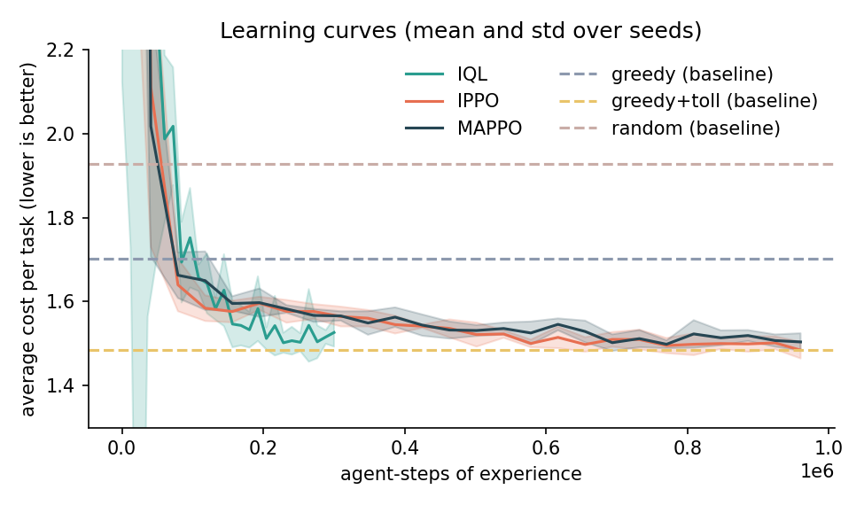
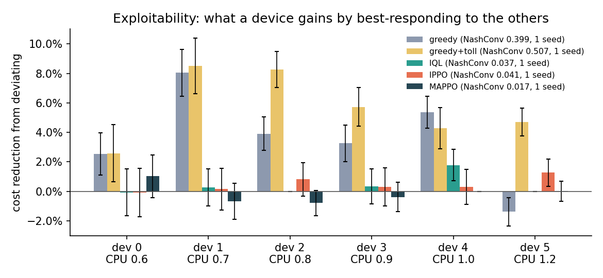

# MARL-Offload

Multi-agent reinforcement learning for distributed computation offloading in an edge-cloud system, with a hierarchical (leader-follower) pricing variant.

This is a small, self-contained research project. It asks two questions. When several heterogeneous devices share an edge server, can independent learners that only use local information coordinate better than a myopic rule? And if the operator of the server sets a price, which price does it choose, and is that price good for the whole system?

An interactive report with all results is built by `python scripts/report.py results` into `results/report_en.html` (English) and `results/report.html` (French). A longer write-up with the mathematical model is in `docs/rapport.pdf` (French).

## The game

N = 6 devices (the agents) receive computing tasks. At every step, each device with a task chooses where to run it:

| action | latency | energy | fee |
|---|---|---|---|
| local | own backlog and task, divided by its CPU speed | grows with CPU speed squared | none |
| edge | upload time + wait in a shared FIFO queue | upload only | price set by the operator |
| cloud | upload time + fixed backhaul delay | upload only | fixed fee |

Each device pays `latency + energy + fee` and minimises its own cost, so the game is general-sum.

- **Coupling through congestion.** The edge queue persists across steps. If everybody offloads now, everybody waits later. Work arrives at about 4.8 units per step and the edge processes 3, so the devices have to share the server.
- **Partial observability.** A device sees its own task, backlog, CPU speed and channel state. It also sees a public signal of the edge load that is `signal_delay` steps old (2 by default). It never sees the other devices' decisions.
- **Asymmetric agents.** CPU speeds range from 0.6 to 1.2, and the radio channels follow two-state Markov chains with different persistence.
- **Leader-follower variant.** The operator posts a price for edge access, and the devices observe it.

The environment uses NumPy only and follows the PettingZoo parallel API style (`marl_offload/env.py`).

## Methods

| method | description |
|---|---|
| all-local, all-edge, all-cloud, random | trivial references |
| greedy | each device picks the option with the lowest estimated cost from its own observation, and assumes that nobody else uses the edge in the same step |
| greedy+toll | greedy plus a virtual surcharge on the edge, tuned on separate seeds. Nobody is paid; the devices just take into account part of the congestion they cause |
| IQL | independent deep Q-learning with a shared network and an agent index, double DQN target and replay buffer |
| IPPO | independent PPO, shared actor, critic V(o_i) |
| MAPPO | centralised training and decentralised execution: same actor, critic V(s, i) on the global state, which includes the true current edge load |

Leader-follower variant (`scripts/stackelberg.py`):

1. **Followers.** One MAPPO policy is trained with a random price at each episode, so it learns a response to any price.
2. **Leader.** The operator learns its price with a UCB1 bandit. It only observes its own payoff after each episode: revenue minus 0.5 times the mean edge backlog. Its choice is compared with an exhaustive sweep over 16 prices.

Distance to equilibrium (`scripts/exploitability.py`, `marl_offload/exploitability.py`): for each device, the other devices are frozen and the device trains a PPO best response. The cost reduction it obtains is its gain from deviating, and NashConv is the sum of the positive gains. A policy profile is a Nash equilibrium when NashConv is 0.

<!-- results:start -->
## Results

All numbers come from `results/*.json`. Costs are averages over 100 evaluation episodes. Learned methods are averaged over 5 training seeds, with a Student-t 95% confidence interval over seeds. Training, tuning and evaluation use disjoint seed ranges.

| policy | cost per task | 95% CI | latency | energy | local / edge / cloud | mean edge backlog |
|---|---|---|---|---|---|---|
| all-edge | 16.445 |  | 16.266 | 0.179 | 0.00 / 1.00 / 0.00 | 45.77 |
| all-local | 4.307 |  | 3.912 | 0.395 | 1.00 / 0.00 / 0.00 | 0.00 |
| all-cloud | 2.691 |  | 2.208 | 0.182 | 0.00 / 0.00 / 1.00 | 0.00 |
| random | 1.927 |  | 1.574 | 0.253 | 0.33 / 0.33 / 0.33 | 0.12 |
| greedy | 1.702 |  | 1.434 | 0.265 | 0.46 / 0.54 / 0.01 | 1.52 |
| greedy+toll (toll 0.8) | 1.484 |  | 1.190 | 0.292 | 0.64 / 0.35 / 0.01 | 0.37 |
| IQL | 1.529 | ± 0.052 | 1.265 | 0.264 | 0.51 / 0.49 / 0.00 | 1.04 |
| IPPO | 1.492 | ± 0.018 | 1.216 | 0.276 | 0.55 / 0.45 / 0.00 | 0.79 |
| MAPPO | 1.526 | ± 0.033 | 1.255 | 0.271 | 0.53 / 0.47 / 0.00 | 0.99 |



**Learners against greedy.** The three learners beat the myopic greedy rule (1.702) by 10% to 12%. Greedy devices react to a stale load signal and herd onto the server. The learned policies send fewer tasks to the edge and keep a shorter queue (mean backlog 0.79 to 1.04, against 1.52 for greedy).

**Learners against a tuned toll.** A greedy rule with a virtual congestion toll of 0.8, tuned on separate seeds, reaches 1.484, slightly lower than every learner, but inside the 95% confidence interval of the best learner (IPPO, 1.492 ± 0.018), so the toll rule and the best learner are on par. On average cost, most of the gain over greedy comes from internalising congestion, which a one-parameter rule already captures.

**Ranking the learners.** The 95% confidence intervals of IQL, IPPO and MAPPO overlap, so the three learners cannot be ranked. The centralised critic of MAPPO brings no measurable gain, even though it sees the true current load.

**Asymmetry.** All policies give the shared server mostly to the slow devices. With MAPPO (mean over seeds), the slowest device (CPU 0.6) sends 65% of its tasks to the edge and the fastest (CPU 1.2) 28%. With greedy the shares are 74% and 42%.


### Leader-follower pricing

The edge price is a transfer from the devices to the operator, so the social cost counts latency, energy and cloud fees, but not the edge price. With MAPPO followers:

- The operator's payoff is highest at a price of 1.2 in the exhaustive sweep. The UCB leader picks the same price (1.2) and plays it in 42% of 600 episodes.
- The social cost is lowest at a price of 0.6: 1.443 per task, against 1.536 at price 0 (6.1% lower). A moderate price acts as a congestion toll.
- At the operator's price, the social cost is 1.482. The operator's price is 2.0 times the socially optimal one, so the two goals are not aligned.
- With greedy followers, the socially optimal price is 0.8.


### Distance to equilibrium

For each device, the other five are frozen and the device trains a PPO best response. For learned policies the best response starts from the device's current policy; for the rules it starts from scratch. The best checkpoint is chosen on validation episodes, and the starting policy is one of the candidates. Before and after are evaluated on the same 300 evaluation seeds. NashConv is the sum over devices of max(0, gain); the raw sum is also reported. Learned policies are analysed on one training seed only (seed 0), for lack of compute time; the rules do not depend on a seed. A gain of +0.000 ± 0.000 means that the starting policy itself was selected.

| policy | NashConv | raw sum of gains | mean gain per device | devices where the last iterate did worse |
|---|---|---|---|---|
| greedy | 0.399 | 0.378 | 3.9% | 5 |
| greedy+toll | 0.507 | 0.507 | 5.7% | none |
| IQL | 0.037 | 0.035 | 0.4% | 0, 1, 2 |
| IPPO | 0.041 | 0.040 | 0.5% | none |
| MAPPO | 0.017 | -0.011 | 0.2% | 1, 2, 3, 5 |

Gain per device (cost before minus cost after, with 95% CI over paired episodes):

| policy | dev 0 (CPU 0.6) | dev 1 (CPU 0.7) | dev 2 (CPU 0.8) | dev 3 (CPU 0.9) | dev 4 (CPU 1.0) | dev 5 (CPU 1.2) |
|---|---|---|---|---|---|---|
| greedy | +0.047 ± 0.026 | +0.146 ± 0.029 | +0.065 ± 0.019 | +0.053 ± 0.020 | +0.087 ± 0.017 | -0.022 ± 0.015 |
| greedy+toll | +0.040 ± 0.030 | +0.131 ± 0.029 | +0.125 ± 0.018 | +0.083 ± 0.019 | +0.062 ± 0.020 | +0.066 ± 0.013 |
| IQL | -0.001 ± 0.027 | +0.004 ± 0.020 | +0.000 ± 0.000 | +0.005 ± 0.018 | +0.027 ± 0.016 | +0.000 ± 0.000 |
| IPPO | -0.001 ± 0.026 | +0.002 ± 0.021 | +0.012 ± 0.017 | +0.005 ± 0.019 | +0.004 ± 0.017 | +0.018 ± 0.013 |
| MAPPO | +0.017 ± 0.024 | -0.010 ± 0.019 | -0.012 ± 0.013 | -0.006 ± 0.015 | +0.000 ± 0.000 | +0.000 ± 0.010 |

The learned policies are much closer to a Nash equilibrium (NashConv 0.017 to 0.041) than greedy (0.399) and greedy+toll (0.507). With a learned policy, a deviating device gains at most 1.8% of its cost, and the gain is significant (95% CI above zero) only for IQL device 4 and IPPO device 5. The gain is significant for 6 of 6 devices with greedy+toll and 5 of 6 with greedy. The toll rule matches the learners on average cost, but it is not stable: single devices gain by ignoring it.

Two caveats. First, for the learned policies the search is local, because the best response starts at the current policy. On several IQL and MAPPO devices, fine-tuning made the last iterate worse and the selection fell back to the starting policy or a checkpoint close to it. A local search that finds no profitable deviation is consistent with a near-equilibrium, but it does not prove one. Second, all best responses are learned, so every value in this section is a lower bound.



## Limitations

- The cloud option is almost never used at a zero price (cloud share 0.000 for MAPPO). With these parameters it is dominated by the edge and local options, so in practice the devices choose between two actions.
- The leader is static (one price per episode), and the follower training does not adapt to the leader's learning.
- The UCB bandit chooses among the same 16 prices as the exhaustive sweep, so it only confirms the sweep.
- Exploitability uses a learned best response, so it gives lower bounds. Learned policies are analysed on one training seed only. The evaluation is paired by seed, but the environment draws all its randomness from one stream, so the two runs of a pair stop sharing random draws once the deviation changes how many devices use the edge.
- For the rules, the best response is trained from scratch for 300 PPO updates. The best checkpoint was the last one for greedy (2 of 6 devices) and greedy+toll (3 of 6 devices), so these best responses may not have converged, and the NashConv of the rules is a loose lower bound.
- The model is stylised: one edge server, an abstract unit of work, and simple channel and energy models.

<!-- results:end -->

## Natural extensions

- **Graph neural network policies.** With several edge servers and a topology, devices and servers form a graph. A GNN encoder for the actor and critic would let one policy transfer across topologies and numbers of agents.
- **Learned dynamic pricing.** Make the leader an RL agent that sets the price at each step from the observed load, trained jointly with the followers.
- **Cooperative versus selfish objectives.** Compare individual rewards with a shared social cost, and measure the price of anarchy.

## Install and reproduce

Python 3.10 or later.

```bash
pip install -e ".[dev]"
pytest -q
python scripts/train.py --out results                 # 5 seeds, parallel processes (--jobs)
python scripts/stackelberg.py --out results
python scripts/exploitability.py --out results        # resumable; --merge-only to aggregate
python scripts/plots.py results
python scripts/readme_results.py                      # writes the Results section of this README
python scripts/check_readme.py                        # checks every number of the README against the JSON
python scripts/report.py results                      # interactive reports (English and French)
```

## Layout

```
marl_offload/env.py             environment (Markov game)
marl_offload/baselines.py       reference policies, toll tuning and evaluation
marl_offload/iql.py             independent deep Q-learning
marl_offload/ppo.py             IPPO and MAPPO
marl_offload/exploitability.py  best responses and NashConv
scripts/                        training, leader-follower, exploitability, figures, README and report generation
tests/                          unit and smoke tests
results/                        JSON results, figures and the interactive reports
docs/                           write-up (French, PDF and LaTeX source)
```

Author: Ossama Sabti (ossamasabti.me)
